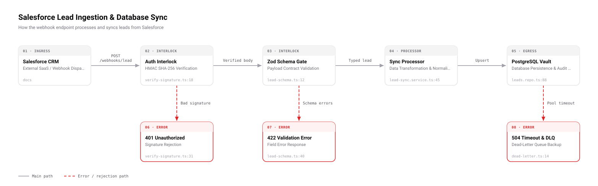
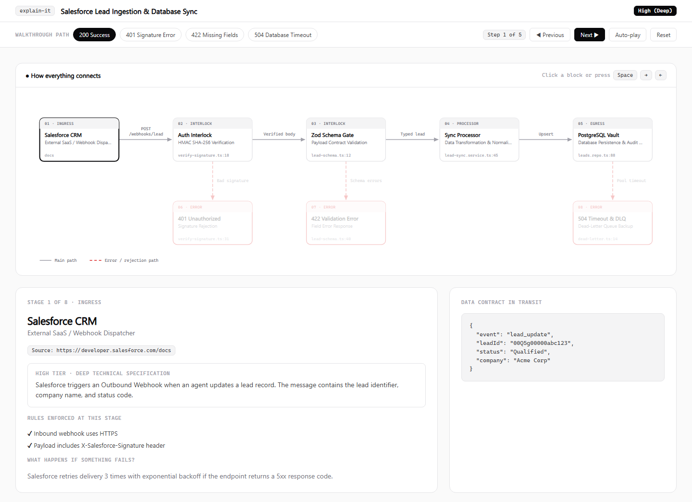

# explain-it

[](https://github.com/andresfgzdev/explain-it/actions/workflows/test.yml) [](LICENSE)

An agent skill that explains **how a piece of software works**: a feature, an API, or a flow across several systems. It writes the explanation in strict **ASD-STE100 (Simplified Technical English)** and draws the whole system as a diagram you can walk through step by step.



<details>
<summary><b>The interactive walkthrough</b>: scenarios, step navigation and a per-stage inspector</summary>



</details>

## What you get

- **An explanation at one depth** that you choose:
  - **Low:** an executive summary.
  - **Medium** (default): one step per hop.
  - **High:** contracts, validations, failure paths and `file:line` references.
  The chat answer and the diagram use the same tier.
- **A system overview SVG** (above). It shows every stage and labelled cable, with error branches in a lane below. You can drop it into a PR or a doc.
- **An interactive HTML walkthrough.** You can pick a scenario (`200 OK`, `401`, `422`, `504`…) and step through it. For each stage, an inspector shows the code reference, the rules it enforces, what happens on failure, and the payload in transit.

Both files are self-contained and work offline.

## Install

**Claude Code (plugin):**

```text
/plugin marketplace add andresfgzdev/explain-it
/plugin install explain-it@explain-it
```

Or add [all my skills](https://github.com/andresfgzdev/skills) at once with `/plugin marketplace add andresfgzdev/skills`, then `/plugin install explain-it@andresfgzdev`.

**Any agent that reads Agent Skills** (Claude Code, Codex, Cursor, Copilot and others) via the [`skills`](https://github.com/vercel-labs/skills) CLI:

```bash
npx skills add andresfgzdev/explain-it
```

**By hand:** copy `skills/explain-it/` into your agent's skills folder (for Claude Code, `~/.claude/skills/explain-it/` or `.claude/skills/explain-it/` in a repo).

## Use

Ask in plain words, for example "explain how the Salesforce webhook reaches our database", "how does PaymentForm talk to the backend? high tier", or "draw our auth pipeline". In Claude Code you can also run it directly:

```text
/explain-it:explain-it trace user registration from UI to DB
```

A run goes:

1. **Trace.** `trace-flow.mjs` lists candidate routes, webhooks, queue consumers, validators, auth checks, DB queries and third-party calls with line numbers. The agent reads the code to confirm each hop.
2. **Model.** The agent writes a flow model (see [`references/flow-schema.md`](skills/explain-it/references/flow-schema.md)), with stages, cables, error branches and scenarios.
3. **Lint.** `ste100-lint.mjs` checks every explanation against ASD-STE100: active voice, approved words, sentence length per tier, and noun clusters.
4. **Render.** `render-schematic.mjs` validates the model and writes the HTML walkthrough and the SVG overview, then opens them.

## Requirements and limits

- **Node.js 18 or later.** It has no dependencies.
- **The scanner only finds candidates.** It uses patterns, not a full parser, so the agent must read the code to confirm each hop. It covers JS/TS, Python, Go, Ruby, Java, C# and PHP route and client patterns.
- **The STE100 linter is heuristic.** Passive voice and noun clusters use word patterns, not grammar parsing. Noun clusters are warnings, not errors.
- **One flow per diagram.** Long paths wrap into rows, but very large systems read better as several focused flows.

## The scripts

All live in `skills/explain-it/scripts/` and run with plain `node`.

| Script | Does |
|---|---|
| `trace-flow.mjs <dir> [--json]` | Lists candidate ingress, interlock and egress hops with line numbers. Read-only. |
| `ste100-lint.mjs <file.md\|flow.json>` | Lints text, or every `ste100` field of a flow model with per-tier limits. |
| `render-schematic.mjs --fixture <flow.json> --out <page.html> [--tier low\|med\|high]` | Validates the model and writes the HTML walkthrough plus `<page>.svg`. |

## Develop

```bash
npm test                 # linter, validation, layout, both renderers, scanner
npm run demo             # renders the sample flow into dist/
npm run demo:docs-site   # a 7-stage flow that wraps into two rows
```

## License

[MIT](LICENSE)
